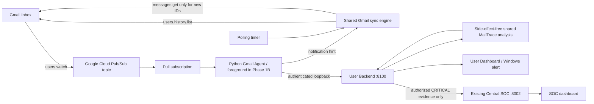

# MailTrace Email Provider Architecture

## Provider decision

For the SIH live demonstration, **Gmail API is the selected mailbox provider**. The previous Microsoft Graph/Outlook plan is superseded for automatic email detection. Existing MailTrace Central SOC APIs/dashboard remain the central investigation platform and are not replaced.

## Proposed runtime topology



Push is the low-latency wake-up; History API is the source of truth and polling is continuous recovery. Gmail's current documentation recommends polling-based synchronization for user-owned devices, and warns that push notifications can be delayed/dropped; therefore the design uses both as requested and must not rely on push alone.

## Components and ownership

| Component | Responsibility | Credential/data boundary |
|---|---|---|
| Gmail API | Mailbox watch, history and message retrieval | User-consented Gmail OAuth, only `gmail.readonly`. |
| Pub/Sub topic/subscription | Store/deliver mailbox-change hints | Gmail system publisher on one topic; Agent subscriber on one pull subscription. No email bodies in messages. |
| Gmail Agent (Phase 1B foreground Python) | Pub/Sub pull, watch renewal, timers, checkpoint recovery and safe diagnostics | Existing Gmail connector uses protected OAuth token; separate Cloud ADC/service identity for subscriber. Service auto-start is future work. |
| User Backend (8100 proposal) | Durable minimal sync/work state, policy/risk results, local dashboard API, privacy enforcement | Separate SQLite store; no SOC DB reuse, no SAFE raw content. Port check found no listener on 8100 at audit time. |
| Shared analysis boundary | Reuse parser/forensics/URL/IOC/IP/domain/risk modules without persistence side effects | Raw content transient; outbound enrichment disabled or policy-gated for SAFE. |
| Existing Central SOC | CRITICAL evidence intake, incident/case routing and analyst investigation | Existing API/auth/DB/ports preserved; confirmed acknowledgement recorded separately. |

## Existing code findings

Phase 1A has implemented a standalone Gmail OAuth/API connector for profile, message listing and message retrieval at `backend/services/gmail_connector/`; the user reports live readonly authorization and metadata calls succeeded. Phase 1B adds local `users.watch`, Pub/Sub pull adapter, History/poll sync, bounded recovery, SQLite cursor/idempotency and a foreground Python Agent. Cloud resources are not configured, so automatic detection is not live-verified. Phase 1B only records opaque message IDs; the Agent does not yet invoke the analysis engine, dashboard, Windows notifications, or Central SOC. The existing SOC backend is FastAPI at `backend/main.py`, uses its own SQLite/file-backed persistence, and its parser/analysis route saves investigations. SAFE/LOW Gmail analysis must use a new side-effect-free invocation and must not post through the current SOC email webhook. Existing model, TI and external enrichment checks can be unavailable; the pipeline must preserve those status values and not fabricate verdicts.

The supported launcher/README configuration is backend 8002 and frontend **5503** (`START_MAILTRACE.ps1`, README). CORS allows both 5503 and 5504, while the offline dashboard prompt still mentions 5503. SIH target 5504 is therefore feasible but requires a deliberate launcher/documentation/prompt change; none was made. `backend/main.py` has a legacy direct-run block for 8000; do not use that entry point. Port **8100** had no listening socket at the prior check. The environment did not have `dotnet` installed and no Gmail/Pub/Sub credentials files were present. See `PHASE_0_1_VALIDATION.md` for the exact source audit.

## Sequence and operating rules

1. User completes desktop OAuth once; Agent starts only with a valid connected account, otherwise reports Authorization Required.
2. Agent calls Gmail `users.watch` after OAuth and stores expiration/baseline. It renews daily, before the seven-day maximum.
3. Pub/Sub pull parses email address/history ID, validates mailbox association, and invokes the common history sync. The hint is not email content.
4. History results generate durable idempotent message-ID work rows and a committed cursor. Pub/Sub ack follows durable DB commit, not just HTTP/Graph/Gmail request initiation.
5. **Phase 1C boundary:** a durable worker consumes only opaque message IDs and updates lifecycle state. It does not fetch message content, parse MIME, analyze threats, classify risk, or transfer evidence. Content processing is future work and requires separate approval.
6. Polling invokes the same sync engine. Network retries, duplicates, reordering, restart recovery and expired-history resync use one checkpoint and unique job ledger.
7. Only CRITICAL evidence authorized by policy is transferred. Record transfer initiation, transport receipt, and SOC incident/analyst acknowledgement as distinct statuses.

The User Dashboard/Windows notification must display real Gmail delivery time, local detection time, scan start/completion, actual verdict, available/unavailable check states, evidence-retention state, and SOC transfer/acknowledgment state. Diagnostics may show authorization/API/PubSub/watch/cursor/pending-job/last-sync/last-scan/failure/recovery metadata, never email content or secrets.

## Installation structure proposed

```text
backend/                         # existing Central SOC, leave in place
shared_analysis/                 # future side-effect-free adapter to existing services
user_backend/                    # future local API and minimal durable sync state, port 8100
windows_agent/                   # future C#/.NET Worker Service, user-scoped OAuth cache
  src/MailTrace.GmailAgent/
  tests/
docs/                            # Gmail setup, design, security and demo runbook
```

This update documents the architecture; it does not create a Gmail connector or start the next implementation phase.

# Phase 1B/1C implementation note (2026-11-20)

The local Gmail sync implementation covers durable opaque message-ID work records. Phase 1C adds metadata-only worker lifecycle transitions in that same store. The worker does not call Gmail `messages.get`, fetch MIME/body/attachments, perform analysis, or transfer SOC evidence. Downstream content processing, dashboard, Windows notification, and authorized Central SOC transfer remain separate phases and must not be described as implemented by this Agent.

