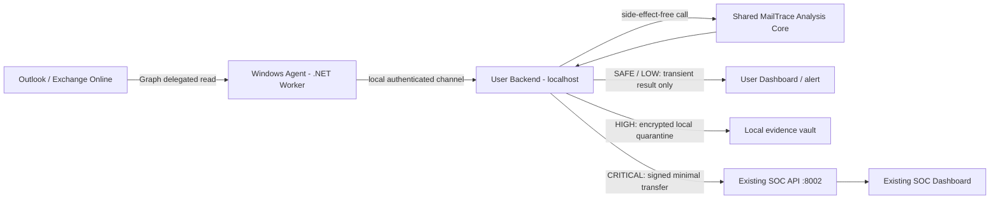
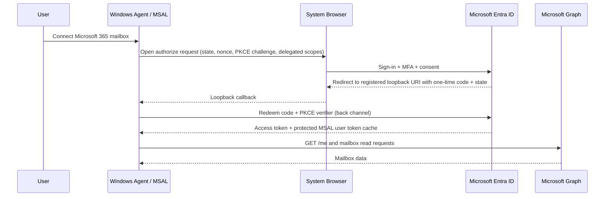

# Outlook and Microsoft Graph Integration Design

> **Superseded for SIH automatic detection.** Gmail API is the selected provider. This document describes the previous Microsoft Graph proposal only; the current design is [EMAIL_PROVIDER_ARCHITECTURE.md](EMAIL_PROVIDER_ARCHITECTURE.md).

## Objective and boundary

The Windows Agent monitors the signed-in user's Microsoft 365 mailbox through Microsoft Graph delegated permissions. Outlook is the employee's mail client; it does not provide MailTrace API credentials or grant Graph permission merely because the account is configured in Outlook. The Agent works while Outlook and the MailTrace dashboard are closed, and does not scrape the Outlook UI or block normal mail delivery.

This is an integration design, not a connector implementation. Do not begin the connector until the actual test mailbox exists and the test app permissions have been granted and verified.

## Components and trust boundary

The Graph token belongs to the Agent's user session. The User Backend does not need a Graph refresh token. The Central SOC receives only a policy-approved CRITICAL package; no SAFE/LOW message or attachment is sent to it.

## OAuth 2.0 Authorization Code Flow with PKCE

Use MSAL.NET public-client APIs and a system browser. A desktop/native app cannot protect a client secret, so none is used. MSAL.NET public clients use PKCE; let MSAL generate and validate the code verifier/challenge rather than implementing token protocol manually. Register the matching native redirect URI (`http://localhost` for a system-browser app, as described in the Entra setup doc).

### Flow lifecycle

1. **Login:** User explicitly chooses Connect. The Agent opens the system browser, uses tenant-specific authority, requests `User.Read` and `Mail.Read` delegated scopes (and OIDC sign-in scopes as required), and relies on MSAL for state/nonce/PKCE.
2. **Consent:** Entra shows the app name and permission descriptions. The user accepts only if the tenant policy permits. If the tenant returns admin approval required, stop and ask the tenant administrator to review/grant the requested scopes.
3. **Authorization-code exchange:** Entra redirects to the registered loopback URI with a short-lived, single-use authorization code. MSAL redeems it over TLS using the PKCE verifier. Never log the callback URL/code. Do not redeem a code twice.
4. **Token cache:** MSAL caches access/refresh tokens per user. Persist its cache only through an OS-protected cache implementation (Windows DPAPI / `Microsoft.Identity.Client.Extensions.Msal` with its protected cache); keep cache ACLs user-scoped. Do not store raw tokens in SQLite, source, logs, analytics, crash dumps, or the User Backend.
5. **Token refresh:** Before Graph calls, ask MSAL for a token silently using the connected account. MSAL refreshes from its secure cache when possible. Do not write custom refresh-token rotation logic. Treat `interaction_required`, revoked consent, account-disabled, Conditional Access, or MFA-required responses as reconnect-required; surface a notification so a user can interactively sign in.
6. **Token expiry:** Use MSAL's returned `ExpiresOn` and acquisition result, not a hard-coded token lifetime. Access tokens expire and refresh tokens can be revoked before their nominal lifetime. Microsoft's default refresh-token lifetime is 90 days for most non-SPA scenarios, but policy/revocation can shorten practical availability. The Agent must recover from token failure and ask for interactive reauthentication.
7. **Logout:** Stop polling/subscriptions, remove the account and its MSAL user-cache entry, delete the protected per-user cache data as supported, clear local mailbox connection state, and report disconnection. Logging out of MailTrace does not necessarily sign the user out of the browser/Windows session.
8. **Permission revocation:** Users/admins can revoke the app's delegated grant through the applicable My Apps/Entra Enterprise Applications controls. A device-loss response can revoke user refresh tokens/sessions. On Graph 401/403 or a revoked refresh token, stop mailbox access, clear stale local state, and require fresh login/consent. Local cache deletion is not server-side consent revocation.

Sources: [desktop sign-in flow](https://learn.microsoft.com/en-us/entra/identity-platform/scenario-desktop-acquire-token-interactive), [authorization code flow](https://learn.microsoft.com/en-us/entra/identity-platform/v2-oauth2-auth-code-flow), [refresh tokens](https://learn.microsoft.com/en-us/entra/identity-platform/refresh-tokens), [MSAL.NET token cache serialization](https://learn.microsoft.com/en-us/entra/msal/dotnet/how-to/token-cache-serialization), [revoke app permissions](https://learn.microsoft.com/en-us/entra/identity/enterprise-apps/manage-application-permissions).

## Mailbox discovery and scanning

1. On connect, call `GET /me` to confirm the signed-in account and show the mailbox identity to the user.
2. Resolve the well-known Inbox and start `GET /me/mailFolders/{inbox-id}/messages/delta` with a small metadata `$select` and a conservative initial window. Persist only the Graph delta synchronization URL/state and identifiers needed for de-duplication; do not store bodies or attachment bytes in the cursor store.
3. Follow every `@odata.nextLink` until Graph returns `@odata.deltaLink`. Use the returned next/delta URL as opaque; do not reconstruct or edit it. On invalid/expired sync state, reinitialize safely with a bounded historical window and deduplicate by immutable Graph ID when supported plus `internetMessageId`/received time.
4. For each newly detected ID, fetch details/header/MIME/attachments only when required. Prefer message `$value` MIME for the existing parser, with strict download size and retry limits. Message IDs and notification events are hints, not trusted content.
5. Send bytes to the side-effect-free shared analysis core in memory. If classification is SAFE or LOW, immediately discard the payload after analysis and save only privacy-approved scan metadata. Never call existing SOC persistence for these tiers.
6. Apply MODERATE/HIGH/CRITICAL policy in the User Backend: authorized user report; encrypted local evidence; or CRITICAL signed SOC transfer, respectively.
7. Run delta again on notification wake-up and on timer/restart. Delta is the recovery/reconciliation mechanism if the Agent is closed, notifications are missed, or network is unavailable.

Microsoft Graph's message delta pattern returns added/updated/deleted items and opaque next/delta links: [message delta](https://learn.microsoft.com/en-us/graph/api/message-delta?view=graph-rest-1.0).

## Change notifications and local Windows operation

An Outlook message subscription can notify the service that a message changed, but Graph webhook delivery requires an internet-reachable HTTPS `notificationUrl`. A listener on `127.0.0.1` cannot receive Graph webhooks. Therefore:

- **First live demo default:** background Agent polls Inbox delta at a reasonable cadence; the worker runs without Outlook/dashboard open.
- **Optional acceleration:** add `POST /subscriptions` only after an approved HTTPS relay/tunnel is available. Subscribe only to the test mailbox Inbox, renew before expiry, handle lifecycle notifications, and immediately reconcile with delta. Do not include message body/attachments in rich notifications.
- **Availability:** keep a persisted delta cursor, retry/backoff for 429/5xx/network loss, respect `Retry-After`, and perform a catch-up delta on startup and after subscription recovery.
- **Delivery:** the Agent observes mail after Exchange delivery; it does not delay or block delivery. Quarantine is a separate, explicitly authorized future feature and would require mailbox mutation permissions not requested by this design.

Sources: [Outlook change notifications](https://learn.microsoft.com/en-us/graph/outlook-change-notifications-overview), [webhook requirements and validation](https://learn.microsoft.com/en-us/graph/change-notifications-delivery-webhooks), [lifecycle recovery](https://learn.microsoft.com/en-us/graph/change-notifications-lifecycle-events).

## Secure local channel and token handling

- Bind User Backend only to loopback. Agent-to-backend requests should use an OS-protected local credential or named pipe ACL; authenticate the Agent and reject browser-originated token requests.
- Do not expose Graph tokens to JavaScript/dashboard storage or send them to the existing SOC backend.
- Keep the Graph token cache only in the Agent process and protected per Windows user. Prefer DPAPI CurrentUser or MSAL's protected desktop cache. If secure storage is unavailable, fail closed and require reauthentication; do not fall back to plaintext token storage.
- Redact Authorization headers and token-bearing error bodies from HTTP logs. Do not include email body, MIME, attachment bytes, access tokens, refresh tokens, PKCE verifier, or auth code in diagnostic logs.
- Use HTTPS to Microsoft endpoints, standard certificate validation, least-privilege delegated scopes, bounded HTTP timeouts/retries, and request IDs without message contents.
- The user can disconnect the mailbox and clear local token cache; provide separate guidance for revoking Entra consent.

## Test/acceptance checklist (once tenant setup exists)

- [ ] `GET /me` returns the expected test mailbox and tenant.
- [ ] Inbox listing and one test message body/header read succeed with delegated consent only.
- [ ] Attachment list/bytes succeed for a benign sample, respecting size limits.
- [ ] Delta bootstrap produces nextLink(s) then deltaLink; a newly delivered test message appears once.
- [ ] A second poll/restart and duplicate notification do not create duplicate scans.
- [ ] With Outlook closed and dashboard closed, Agent remains active and catches a new message.
- [ ] SAFE/LOW content is absent from DB, logs, files, browser storage and SOC payloads after analysis.
- [ ] Token cache is protected; logs contain no credentials/tokens; expiration/revocation requires safe reconnect.
- [ ] No mailbox write/delete/send permission is granted and no message state is changed.
- [ ] If webhook notifications are enabled, public HTTPS validation/lifecycle/renewal works; delta catches up after missed notification.

