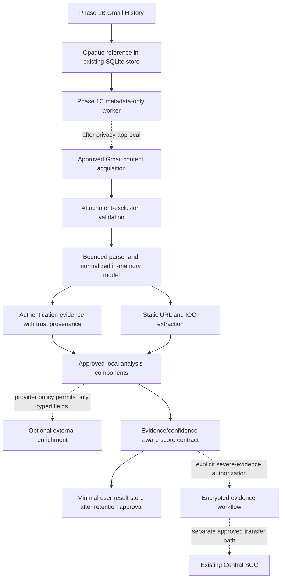

# Phase 2A — Threat Analysis Integration Plan

**Original Phase 2A status:** audit/design only. **Current Phase 2A.1 status:** metadata-only acquisition and minimal data policy are approved; no parser is wired to Gmail and no application implementation was authorized. Content acquisition and analysis remain blocked. See [PHASE_2A_1_PRIVACY_POLICY.md](PHASE_2A_1_PRIVACY_POLICY.md) for exact status labels and decisions.

## 1. Architecture recommendation

Preserve the Central SOC route, DB, dashboard, authentication, cases, evidence custody, and ports (backend 8002 / frontend 5503). Keep Gmail synchronization and its metadata-only worker independent. If content analysis is approved later, build a separate content acquisition boundary and a side-effect-free service adapter; do not make the Gmail worker call `main.py::_analyze_email` or reuse `/api/analyze-email`.

Steps D onward are **not authorized** by this task. The drawing is a dependency model, not a claim that those components have been implemented.

## 2. Reuse and integration boundaries

| Component | Planned treatment after approval | Required boundary |
|---|---|---|
| `parse_email_bytes` | Reuse as a bounded parser only if the approved acquisition can exclude attachments at the transport boundary. | Return a minimal normalized representation; do not persist source buffer or `Message` object. Confirm limits and defect behavior. |
| `parse_email` | Refactor into separate pure extraction and explicit opt-in analysis adapters; do not call it directly from Gmail. | Eliminate implicit DNS/IP/provider/ClamAV behavior; never include all body/headers in default result. Maintain existing SOC response contract with regression tests. |
| `email_forensics` | Reuse explicit deterministic header/IP parsing and independent validation functions with trust provenance. | Gmail lacks trusted ingress SMTP context by default. Header-reported auth results remain untrusted. SPF must be `UNVERIFIED` without trusted SMTP facts. |
| URL/IOC components | Reuse static extraction and normalizers with allowlisted output. | Bound count/size; redact full URL values; no URL fetching; external query values forbidden unless separately approved. |
| Domain/IP/TI providers | Keep behind a provider-policy interface, disabled unless approved per indicator type. | Per-provider allowlists, timeouts, no raw message transfer, no private URL values, explicit unavailable states. |
| Email AI | Use only local approved artifact after confirming artifact provenance, calibration, network behavior and privacy. | Model score is one evidence source, never a standalone SAFE/HIGH/CRITICAL disposition. Model unavailable state must remain explicit. |
| Intelligence fusion | Candidate canonical fusion API after independent regression and policy approval. | Preserve evidence provenance, confidence, coverage, correlation handling and degraded status. Do not silently use fallback as a complete verdict. |
| Privacy governance/evidence custody | Reuse selectively after separate Gmail retention and encryption design. | Current labels are data sensitivity, not threat severity; encryption key absence must block sensitive persistence; don't share SOC vault by default. |
| Existing SOC `/api/analyze-email` | Preserve for current SOC upload behavior. | Do not route Gmail content through it: it persists subject/sender/recipient and `analysis_json`, preserves raw evidence, and can trigger existing gateway/alert paths. |
| Gmail `gmail_detected_messages` | Continue to store opaque reference and Phase 1C lifecycle metadata. | Do not put content, analysis JSON or provider result payload in this queue. |

## 3. Dependency-ordered implementation phases (future approval required)

### Phase 2A — Audit/design (this task)

- Record current component behavior, call graph, persistence, external egress and security controls.
- Identify privacy, acquisition and classification blockers.
- Produce a threat-analysis integration proposal and test plan.
- No content access, code wiring or runtime behavior changes.

### Phase 2B — Content acquisition and analysis policy (BLOCKED; separate approval required)

- Approve source/API response format and technically demonstrated attachment exclusion.
- Approve exact headers/body fields, size/part bounds and malformed/oversized behavior.
- Approve RAM-only controls, logs/crash behavior, classification/risk vocabulary, provider allowlist, persistence, encryption, retention, deletion and access roles.
- Record named policy owner, version and acceptance evidence.

Phase 2A.1 approved metadata-only operation and prohibited body/MIME/attachment acquisition. It did not approve content processing, key implementation, schema migration, retention implementation, provider egress, or threat classification. No Phase 2B implementation has started.

### Phase 2C — Pure analysis boundary (only after Phase 2B approval)

- Build a new side-effect-free adapter around audited parser/extractor components, preserving SOC API output through a compatibility adapter.
- Define typed inputs/outputs with explicit statuses (`PASS`, `FAIL`, `UNKNOWN`, `ERROR`, `NOT_RUN`, partial); do not treat missing checks as safe.
- Inject outbound providers only through a policy-gated interface. Default provider set is empty.
- Make no Gmail-specific persistence or SOC forwarding in this phase.

### Phase 2D — Risk/classification validation (policy and labeled evidence required)

- Reconcile current parser/fusion/gateway thresholds and decision vocabularies.
- Specify score source, confidence, independent evidence, coverage, model-only and partial-parser handling.
- Evaluate against approved, provenance-documented fixtures; report calibration, precision/recall, false positive/negative and coverage per class.
- Require analyst review where evidence is insufficient. Do not label a low score SAFE when checks were unavailable.

### Phase 2E — Gmail content adapter (separate approval and privacy regression gate)

- Implement only the approved content acquisition format and attachment exclusion control.
- Re-fetch from Gmail using `gmail.readonly` only after worker claim; never persist raw content in queue/store/logs.
- Process transiently, release references/buffers, record minimal approved result/state, and use retries that do not duplicate analysis or provider egress.
- Deny content processing if auth is revoked, limits are exceeded, encryption policy is unmet, or the privacy policy is unavailable.

### Phase 2F — Operational/security review

- Review local user binding, authorization, revocation, retention/deletion, crash dumps, logs, backups, API response redaction and provider egress.
- Run regression suites for SOC auth/tenant/evidence/parser/analysis behavior and the complete new privacy matrix.
- Only after separate approval may this flow be connected to dashboard, evidence quarantine or Central SOC transfer phases.

## 4. Required test plan before any content implementation

### Existing regression tests to preserve

- `backend/tests/test_email_processing_security.py`: forged `Authentication-Results`, auth provenance, parser limits/MSG conversion and secure webhook behavior.
- `backend/tests/test_email_alerting_policy.py`: incomplete evidence, confidence gates, attachment scan state, decision and signed gateway receipt behavior.
- `backend/tests/test_phase4_step17_analysis_api.py`, `test_phase4_ml_only_risk_cap.py`: score/fusion/API regression and model-only risk handling.
- `backend/tests/test_threat_intel_http_clients.py`, `test_threat_intel_provider_orchestration.py`: provider timeout, credential and failure-state behavior.
- `backend/tests/test_investigation_routes_security.py`, `test_access_control_oidc.py`, `test_alert_tenant_isolation.py`, `test_evidence_error_sanitization.py`: access controls, tenant isolation and error redaction.
- Parser/MIME, URL/IOC, attachment scanner, result-state and evidence custody/privacy governance tests discovered under `backend/tests` and their module test directories.

No tests were executed for Phase 2A. The list above is an implementation gate, not a pass claim.

### New tests required before Gmail content is enabled

1. Acquisition contract denies unapproved formats and proves attachment bytes are not returned/decoded/fetched.
2. No content read occurs before explicit user authorization, consent, valid readonly token and worker claim.
3. Invalid/oversized MIME fails closed without content in logs, error responses, temp files, crash metadata, DB, telemetry or queue.
4. Forged headers cannot produce validated SPF/DKIM/DMARC. Gmail without trusted SMTP context leaves SPF unverified.
5. Provider allowlist tests assert exact typed fields and reject body, headers, private URLs, query/fragment/userinfo, credentials and attachment bytes.
6. Provider timeout/rate limit/unavailable states cannot be converted into benign/SAFE verdicts.
7. Fusion score, provenance, confidence, independent evidence, coverage and degraded fallback are reported consistently; classification has policy-version evidence.
8. No SAFE/LOW content persistence; high-severity persistence is blocked without approved encryption and authorization; retention/deletion and key rotation are tested.
9. Authz tests bind every mailbox/reference/result/evidence object to the proper principal and tenant; revocation and account disconnect remove/disable access.
10. Idempotent worker crash/restart tests prove no duplicate analysis or duplicate external provider submission.
11. Existing SOC route response, persistence, gateway actions, database schema, frontend and ports 8002/5503 remain regression-clean.
12. Any live Gmail integration test uses a dedicated approved mailbox and policy-authorized content. It is separate from mocked tests and runs only after the privacy gate is signed off.

## 5. Decision dependencies and remaining blockers

| Blocker | Why it blocks implementation | Approval/evidence needed |
|---|---|---|
| Gmail body acquisition versus attachment exclusion | Full/raw MIME may include inline attachment payload; no approved selective content retrieval exists. | Chosen retrieval mode plus testable proof no attachment bytes are fetched. |
| No Gmail privacy policy | Current SOC retention rules do not authorize user Gmail content. | Signed field-level allow/deny, processing, retention and deletion policy. |
| No classification mapping | Existing code has conflicting scores/thresholds and different privacy-vs-threat labels. | Policy owner-approved vocabulary, evidence criteria, thresholds, calibration and review behavior. |
| External provider disclosure | Domain/IP/URL/hash indicators are disclosed by current provider paths. | Per-provider IOC field allowlist, purpose, terms/consent and redaction tests. |
| Encryption fail-open in nonproduction | Sensitive DB/evidence helpers can store plaintext when no key is configured. | Separate Gmail encrypted store and fail-closed key/rotation/backup/recovery controls. |
| Gmail authorization model | SOC tenant auth does not bind a mailbox or its evidence to a local Gmail owner. | Principal/mailbox ownership, role, revocation and audit specification. |
| Memory/crash behavior | Python runtime cannot promise zeroization; crash dumps and debugging could capture memory. | Approved local process controls and documented residual risk. |

## Phase 2A.1 policy finalization update — 2026-11-20

- **APPROVED:** continue metadata-only sync; do not fetch body/full MIME/attachments or analyze Gmail content.
- **APPROVED:** message ID only as necessary; thread ID conditional; internal date may be stored; sender/recipient only when necessary and encrypted/restricted; no subject, full headers, body, attachment names or bytes.
- **VERIFIED (source inspection only):** current Gmail store has message ID and lifecycle fields only. It does not store internal date, sender or recipient. Metadata getter still selects `Authentication-Results` alongside `From`, `To`, `Date` and RFC `Message-ID`; policy enforcement/allowlist correction is **NOT IMPLEMENTED**.
- **PROPOSED / PENDING APPROVAL:** AES-256-GCM envelope and separate OS-protected KEK, recovery/rotation, role model, content-free access auditing, retention periods, external-provider allowlists and final outcome criteria.
- **APPROVED:** no external service calls during Phase 2A.1; missing keys/authorization/privacy control/tenant ownership fails closed.
- **BLOCKED:** any Gmail body/MIME/attachment acquisition, threat analysis, quarantine or SOC evidence transfer. Reliable attachment-byte exclusion and separate approval are prerequisites.
- This phase updated documents only: no app code, DB/schema/records, `.env`, OAuth credentials/token cache, ports or services were changed. No content was fetched, no external service was called, and no tests were run.

The remaining approval dependencies are detailed in [PHASE_2A_1_PRIVACY_POLICY.md](PHASE_2A_1_PRIVACY_POLICY.md). Phase 2B implementation and Phases 2C–2F must not begin automatically.

## Phase 2A.2 prototype-readiness update — 2026-11-20

See [PHASE_2A_2_PROTOTYPE_READINESS.md](PHASE_2A_2_PROTOTYPE_READINESS.md) for the focused source review and synthetic-only readiness plan.

- **READY WITH RESTRICTIONS:** a separately approved Phase 2B may use local synthetic `.eml` fixtures, bounded `parse_email_bytes`, a pure/minimal adapter, offline checks, sanitized in-memory results, and explicit incomplete outcomes.
- **BLOCKED:** calling `parse_email` directly from the Gmail worker or reusing the SOC `/api/analyze-email` route. The parser orchestrator performs attachment decoding/scanning, domain/IP/URL analysis and returns content-bearing data; the SOC route adds broader analysis and persistence.
- **BLOCKED:** Gmail body/MIME/attachment acquisition and Gmail-content analysis under the Phase 2A.1 policy. No such content was fetched in Phase 2A.2.
- **NOT IMPLEMENTED:** the metadata header allowlist still requests `Authentication-Results` along with `From`, `To`, `Date`, and `Message-ID`; align it with the approved policy in a separate connector task.
- **PENDING APPROVAL:** one score-to-outcome mapping and evidence/coverage criteria. Parser, SOC and gateway tiers differ. Missing/unavailable/error checks must remain distinct and cannot yield SAFE.
- **BLOCKED:** sensitive result/evidence persistence until key absence is fail-closed; existing AES-GCM helpers return plaintext in development when no key is configured.
- Phase 2B plan is synthetic-only: bounded ingestion; provenance-aware authentication; offline phishing checks; safe IOC extraction; approved fusion mapping; sanitized in-memory report; test gates. No network provider, Gmail, SOC, vault, or database integration is in that initial boundary.

This update changes planning only. It does not authorize Phase 2B or change code, database, Gmail behavior, ports, or SOC workflows.

## Phase 2B synthetic prototype implementation update — 2026-11-20

- **IMPLEMENTED (synthetic-only):** `backend/services/synthetic_analysis/` provides an in-memory adapter, offline authentication evidence mapping, prototype scoring, and an analyst-protected upload route at `/api/synthetic-analysis`.
- **REUSED:** bounded `parse_email_bytes`, existing local untrusted authentication-claim extraction, static link deception analysis, URL extraction, IOC normalization, and offline domain alignment. The broad `parse_email` function and `/api/analyze-email` route are not used by this feature.
- **IMPLEMENTED:** 1 MiB upload/message cap, 256 KiB decoded body cap, parser MIME/header limits, single-part text-only acceptance, multipart/attachment-disposition rejection, URL credential/path/query/fragment redaction, content-free errors, and no analysis persistence.
- **IMPLEMENTED:** explicit `synthetic-demo-policy-1` weights/cutoffs as non-calibrated prototype heuristics. Any mandatory check not PASS prevents SAFE; real API auth checks remain unavailable. No new gateway or SOC scoring was changed.
- **TESTED:** see [PHASE_2B_TEST_REPORT.md](PHASE_2B_TEST_REPORT.md): 116 focused synthetic/parser/URL/IOC, Gmail mocked/metadata, and SOC fusion-unit tests passed; Python compilation passed. Existing Phase 4 analysis API regression remains unverified because Windows event-loop initialization hung in `socket.socketpair` before assertions.
- **BLOCKED:** Gmail acquisition and analysis, real DNS/auth validation, external reputation, database persistence, quarantine, evidence transfer, and Central SOC integration remain out of scope.

These results do not alter the Phase 2A.1 Gmail privacy decision or authorize Phase 3.

## Phase 2B completion update — 2026-11-21

- **COMPLETE WITH RESTRICTIONS:** the synthetic-only workflow now performs bounded DNS policy checks, DKIM cryptographic verification, DMARC policy/alignment evaluation, explainable scoring, and sanitized report persistence.
- **INTEGRATED:** tenant/owner-scoped report retrieval, idempotent submission using a persisted digest, and retryable delivery to existing Central SOC investigations/cases/alerts. Only generic synthetic labels and sanitized structured evidence are passed into the SOC workflow.
- **VERIFIED:** synthetic HTTP upload-to-report-to-SOC-to-retrieval flow using temporary SQLite and mocked DNS/auth results. The full offline backend regression suite passed on native Windows; see [PHASE_2B_COMPLETION_REPORT.md](PHASE_2B_COMPLETION_REPORT.md).
- **LIMITED:** SPF message evaluation requires trusted SMTP ingress facts that standalone `.eml` fixtures do not contain. The upload reports SPF policy publication separately and leaves the message check unavailable in that situation. Automated DNS tests are mocked; live DNS testing is opt-in and was not performed.
- **STILL BLOCKED:** Gmail content acquisition/analysis, external reputation calls, quarantine/evidence transfer, and Phase 3. This update does not authorize any of those activities.
