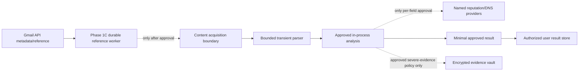

# Phase 2A — Gmail Threat Analysis Privacy Design

**Original Phase 2A status:** proposal and decision register only. The original open decisions below are retained as history. **Current Phase 2A.1 status:** metadata-only acquisition and minimal data handling are approved as recorded in [PHASE_2A_1_PRIVACY_POLICY.md](PHASE_2A_1_PRIVACY_POLICY.md); content acquisition/analysis remains blocked and other decisions remain pending. Phase 1C stays metadata-only.

## 1. Data-flow boundary

No raw message or content-bearing result may pass through the existing `/api/analyze-email` SOC upload endpoint as a shortcut. Its current path writes investigations, analysis output and evidence. The existing Gmail worker should stay independent until a separate adapter is approved.

## 2. Policy decision register

| Decision | Current evidence | Required decision / safe default |
|---|---|---|
| Gmail API format | Phase 1A supports `metadata`, `full`, `raw`; Phase 1C uses none. `full` and `raw` may return MIME content and inline attachment data. | **OPEN:** explicitly approve a format and demonstrate how attachment bytes are excluded before they enter the local process. Until then, do not call `messages.get`. |
| Attachment retrieval | Gmail MIME bodies may contain inline payload or separate attachment references; current `parse_email` decodes attachment payloads. | **OPEN:** no attachment bytes may be requested, decoded, copied, persisted, scanned, or sent externally absent a specific later approval. Decide whether attachment metadata (name/type/size) is allowed. |
| Headers/body scope | Parser currently extracts broad headers and text/HTML body; headers may include credentials, reset links and personal data. | **OPEN:** define exact header allowlist and whether plain-text body, HTML body, or neither is permitted. Default deny content. |
| Oversized/malformed message | Existing parser limits raw input to 25 MiB, MIME to 1,000 parts, nesting to 20, headers to 1,000. Gmail retrieval path has no approved Phase 2 content handling yet. | **OPEN:** choose stricter acquisition limits, fail-closed status, retry/permanent handling and safe diagnostics. Never truncate and then report a complete analysis. |
| Transient memory | Python parser and analysis return objects containing content; no zeroization guarantee was found. Garbage collection does not guarantee memory erasure. | **OPEN:** approve a dedicated process boundary, bounded buffers, short lifetime, no disk-backed temp, no swap/crash dump policy, no content exception strings, and cleanup behavior. Document residual memory/OS limitations honestly. |
| Threat classification | Existing layers use different thresholds/vocabularies; privacy governance uses different data classifications. | **OPEN:** define SAFE/HIGH/CRITICAL evidence requirements, confidence/coverage requirements, review state and versioning from approved policy and labeled validation. Do not infer tier from score alone. |
| Persistence | SOC DB may store full `analysis_json`; AES-GCM depends on environment key. Evidence bytes are plaintext if the key is missing. | **OPEN:** explicitly list fields allowed in metadata DB; prohibit bodies, raw MIME, private URLs/headers/attachments by default; require encryption at rest to fail closed for any approved sensitive persistence. |
| Retention/deletion | SOC data governance has PUBLIC/INTERNAL/SENSITIVE/RESTRICTED defaults (30/90/180/365 days) plus holds; these are not Gmail content authorization. | **OPEN:** set Gmail-specific retention per field, dedupe tombstone lifetime, deletion semantics, backup deletion, retry retention and legal/forensic hold controls. Default retain no content. |
| External services | Current parser path can issue DNS, geolocation, reputation and cached/live threat-intel requests. | **OPEN:** approve provider, purpose, exact IOC type/fields, region/terms, retention and consent. Until explicit allowlist: no email-derived external request. |
| Access | SOC supports bearer API-key/OIDC and tenant checks, with local-loopback development behavior and some legacy/global stores. | **OPEN:** define per-mailbox owner, report/evidence viewer, administrator, export, audit, revocation and account-removal permissions. Default deny all users except the explicitly connected local identity. |

## 3. External disclosure inventory and proposal

This inventory describes existing possible egress, not approved egress.

| Destination / mechanism | Data that may leave process | Proposed initial privacy decision |
|---|---|---|
| System DNS / dnspython | Sender/link domains; DKIM selector domains; `_dmarc` domain; A/AAAA/MX/NS query names | **Disabled for Gmail content until approved.** DNS operators learn queried names and timing. Consider an explicit resolver policy and per-check `NOT_RUN` states. |
| SPF library | SMTP client IP, envelope sender and HELO, when trusted gateway context exists | Gmail API path has no trusted SMTP socket context by default; keep `UNVERIFIED_NO_TRUSTED_SMTP_IP`, do not derive trust from untrusted headers. |
| DKIM/DMARC DNS validation | DKIM selector/domain DNS name and sender domain | Requires authorization for DNS disclosure; DKIM signature may be verified locally against DNS but needs the signature/header bytes transiently. DMARC lookup is not proof that a specific message passed DMARC. |
| ipapi.co / ip-api.com / ipinfo | Public IP from Received/relay evidence; request source IP, timing and provider API key as applicable | **Disabled by default** pending IP disclosure policy; public-IP filtering is not user consent. Returned location is approximate infrastructure context, not sender identity. |
| VirusTotal | Supported IOC such as IP, domain, URL or file hash; API key | **Disabled by default** until exact IOC fields are approved. Never submit full message, raw headers, full body, credentials, private URL path/query or attachment bytes. Hash submission can still disclose a stable correlator. |
| AbuseIPDB | Public IP indicator and API key | **Disabled by default** pending approval of IP egress and provider terms. |
| ThreatFox / URLhaus | IOC values (potentially domain/URL/IP/hash) and API key | **Disabled by default** pending type-specific allowlist. Strip/deny userinfo, query, fragment, private hostnames and URL tokens unless separately approved. |
| WHOIS / RDAP | No approved email-path integration identified in inspected code | Keep `NOT_RUN`; do not add a provider as part of reuse. |
| Local model | Email body and fields are supplied to local inference by the SOC route | Local processing is still sensitive processing. Verify model path, logs, crash behavior, telemetry and whether any runtime downloads/network access exist before Gmail reuse. Do not upload data to a hosted model. |

Any future integration should centralize egress behind an explicit provider-policy interface. The interface should receive typed normalized indicators, reject disallowed fields before network code, cap indicator count/size, produce per-provider status, and log only provider/status/category—not indicator values, URLs, keys or message content.

## 4. Proposed transient-processing safeguards (not implemented)

- Keep Phase 1C metadata-only until the acquisition gate is signed off.
- Isolate future content handling from the SOC web route and general-purpose queue/logging infrastructure.
- Never serialize parsed message objects or full result dictionaries into jobs, telemetry, exception reports, or API logs.
- Use bounded response reads and parser limits before deeper analysis; define stricter policy caps based on SIH needs.
- Avoid writing temporary `.eml`/MIME files. If an approved dependency requires a file, stop and obtain a separate reviewed exception with encrypted ACL-protected temp storage and verified cleanup.
- Catch exceptions at provider/analysis boundaries and emit allowlisted error category/status only; do not include exception messages, request URLs or raw provider responses.
- Keep the message object, raw buffer, extracted bodies and attachment buffers local to the shortest synchronous scope possible. Python cannot guarantee secure zeroization; document this residual limitation and assess process isolation/OS dump controls.
- Ensure debug logs, tracing, API response schemas, monitoring labels, test failure artifacts and crash dumps cannot serialize the content-bearing objects.
- Don't fetch attachments. A content acquisition design that cannot enforce this transport boundary is not acceptable under the current constraint.

## 5. Proposed persistence classes (needs approval)

### Candidate minimal operational metadata

Potentially retain only mailbox-binding key, opaque Gmail message ID, synchronization cursor, processing timestamps/state, attempt counter, sanitized error category, policy version, analysis status, and references to separately governed evidence. Message IDs are sensitive correlators and require an approved retention period and access control.

### Prohibited by default

Raw email/MIME bytes; body text/HTML; subject; sender/recipient and other personal headers; full URL, especially path/query/fragment/userinfo; authentication headers; attachment bytes or filenames; OAuth/Pub/Sub credentials; complete parser results; model input/output snippets; raw provider requests/responses; exception strings.

### Encryption and fail-closed behavior

Existing AES-GCM helpers use configured `MAILTRACE_DATA_ENCRYPTION_KEY` or key ring. When no key is configured, helper functions return values/bytes unchanged. Therefore any approved sensitive persistence must require and validate encryption configuration before acquisition, not after it. Key custody, rotation, backup, recovery, AAD/versioning, access audit, and deletion must be designed. Existing SOC `analysis_json`/evidence vault is not a default Gmail store.

## 6. Classification and action boundary

Do not define numerical thresholds in this phase. Policy owner and security reviewers must approve:

1. Evidence types that can support SAFE versus unresolved/unknown.
2. Independent corroboration and confidence/coverage requirements for HIGH/CRITICAL.
3. How unavailable SPF, DKIM, DMARC, DNS, provider, model, parser and attachment checks affect verdicts.
4. Partial parse, malformed content, authentication ambiguity, model-only signal and provider disagreement behavior.
5. Whether labels are threat tiers, action dispositions, or both; keep these distinct.
6. Whether any action (alert, quarantine, evidence retention, SOC transfer) is allowed and who authorizes it.

Until approved, result is `NOT_ANALYZED`/`REVIEW_REQUIRED` metadata only; no SAFE, HIGH, CRITICAL or benign label should be emitted by a Gmail feature.

## 7. Required approval record before crossing gate

Approval should name the policy owner and version, acquisition method/format, attachment exclusion proof, allowed fields, maximum content/part sizes, transient safeguards, external provider allowlist, persistence schema, encryption requirement/key owner, retention/deletion schedule, role/access matrix, classification/risk policy, and acceptance tests. A change in any of those requires policy review before content processing resumes.

**Decision at original Phase 2A audit time:** unresolved. The later Phase 2A.1 decision record below supersedes the acquisition/minimal-metadata portion; remaining privacy and implementation gates are still pending or blocked.

## Phase 2A.1 policy update — 2026-11-20

- **APPROVED:** metadata-only Gmail operations; no body, full MIME or attachment retrieval; no content processing/analysis.
- **APPROVED:** Gmail message ID only as operationally needed; thread ID only if needed; Gmail internal date may be stored; sender/recipient may be collected only when needed and must be encrypted/restricted; subject, full headers, body, attachment names and bytes are prohibited as specified in the policy.
- **NOT IMPLEMENTED:** the current Phase 1A metadata getter still requests selected `From`, `To`, `Date`, `Message-ID`, and `Authentication-Results` fields; Gmail store does not encrypt sender/recipient or record internal date. No code changes were authorized in 2A.1.
- **PROPOSED / PENDING APPROVAL:** AES-256-GCM envelope and Windows-protected KEK storage/recovery/rotation; role-based decryption; Gmail-specific retention/deletion periods; external provider allowlists; final threat outcome criteria.
- **APPROVED:** no external provider calls in 2A.1; fail closed on missing authorization, keys, policy, tenant ownership or secure evidence storage.
- **BLOCKED:** Gmail content processing stays prohibited until a separate policy approval establishes reliable attachment-byte exclusion. No content was fetched or analyzed during 2A.1.
- **VERIFIED (source/config defaults only):** the original register's 30/90/180/365 figures are enum defaults, not effective Gmail policy. SOC startup defaults override INTERNAL/SENSITIVE/RESTRICTED to 365/730/1095 days (environment-configurable); none is approved for Gmail.

For the complete field matrix, source-verified implementation status, retention proposals and role/provider policy, see [PHASE_2A_1_PRIVACY_POLICY.md](PHASE_2A_1_PRIVACY_POLICY.md). This update does not claim encryption, RBAC, deletion scheduling or threat classification is implemented.
