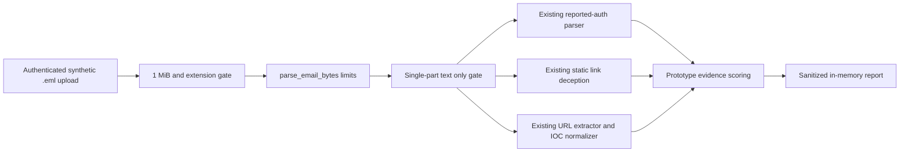

# MailTrace AI — Phase 2B Synthetic Threat Analysis Engine

**Status (2026-11-21):** COMPLETE for the synthetic-only prototype, with live Gmail content analysis BLOCKED.  
**Engine version:** `synthetic-offline-1.0`  
**Scoring policy:** `synthetic-demo-policy-1`

## Boundary and data flow

`POST /api/synthetic-analysis` accepts an authenticated analyst's local `.eml` upload, runs bounded parsing, authentication checks, and offline local checks, then stores only the sanitized report. It creates the SOC investigation and alert through existing database functions. The existing `/api/analyze-email` route and SOC behavior remain unchanged.

The handler rejects multipart and attachment-disposition messages after bounded syntax parsing. Accepted prototype fixtures must be attachment-free, single-part `text/plain` or `text/html`. Bytes and decoded content are transient in process memory; Python does not guarantee memory zeroization. No raw fixture, body, subject, full headers, MIME object, attachment data, or content excerpt is returned or persisted.

## Modules and reused components

| Module | Responsibility |
|---|---|
| `backend/services/synthetic_analysis/api.py` | Analyst-only upload route; `.eml` and size validation; content-free failure responses; no persistence. |
| `backend/services/synthetic_analysis/engine.py` | Bounded parser adapter, attachment/multipart rejection, minimal transient extraction, sender checks, URL/IOC redaction, report assembly. |
| `backend/services/synthetic_analysis/authentication.py` | Reuses the existing reported authentication parser; separates untrusted header claims from mock-only test statuses and unavailable independent checks. |
| `backend/services/synthetic_analysis/scoring.py` | Deduplicated evidence scoring and incomplete-analysis verdict policy. |
| `backend/services/synthetic_analysis/verification.py` | Bounded SPF policy/DNS, DKIM cryptographic, and DMARC policy/alignment checks. TXT DNS resolver is injectable and limited to eight lookups per analysis. |
| `backend/services/synthetic_analysis/store.py` | Tenant/owner scoped sanitized report persistence, idempotency, and bounded SOC delivery retry state. |
| `backend/services/email_parsing.py::parse_email_bytes` | Existing bounded RFC 5322/MIME parser. Limits: 1 MiB endpoint cap (stricter than parser's 25 MiB), 1,000 parts, depth 20, 1,000 headers. |
| `backend/services/email_parser.py::analyze_authentication` | Existing local extraction of untrusted SPF/DKIM/DMARC claims; these claims never override independent verification. |
| `backend/services/link_deception_intelligence.py::analyze_link_deception` | Existing static HTML visible-link/destination analysis; no URL is fetched. |
| `backend/services/url_extraction.py::extract_url_evidence` | Existing static HTTP(S) extraction and URL normalization. |
| `backend/services/threat_intelligence/ioc_normalizer.py::extract_iocs` | Existing local IP/domain/URL validation and deduplication. URL path, userinfo, query and fragment are stripped from report values; source excerpts are omitted. |
| `backend/services/domain_alignment.py` | Existing local IDNA and organizational-domain comparison; packaged suffix data is configured without network refresh. |

`email_parser.parse_email` is not called. Live authentication validation (`validate_email_authentication`), DNS, provider enrichment, model APIs, ClamAV attachment scanning, SOC fusion route, evidence vault, `save_investigation`, and database persistence are not called by this feature.

## Authentication result semantics

- The `Authentication-Results` header is extracted using the existing parser and always marked untrusted. Its values are reported only as `reported_claim`.
- The HTTP route performs bounded DNS lookups. DKIM signatures are verified cryptographically with `dkimpy`; DMARC policy and relaxed/strict SPF/DKIM alignment are evaluated from DNS and verification states.
- SPF policy publication is reported separately. An SPF message PASS requires trusted SMTP client IP, HELO, and MAIL FROM context; a synthetic `.eml` upload cannot establish that context, so its SPF message result remains `UNAVAILABLE` while policy lookup may be `POLICY_FOUND`. No uploaded `Received-SPF` or `Authentication-Results` value is trusted.
- DNS timeouts, lookup limits, absent records, malformed records, and cryptographic failures remain distinct (`UNAVAILABLE`, `NONE`, `INVALID`, and `FAIL`). No live DNS integration result has been claimed; automated tests inject DNS responses.
- Missing claims do not become PASS. Reported PASS does not become verified PASS.
- The test-only internal `mock_authentication` argument can exercise state mapping; the HTTP API has no parameter for it. Mocked PASS is explicitly labelled `MOCK_ONLY_NOT_LIVE_VERIFICATION`.
- Sender-domain alignment is independently evaluated when authentication evidence is sufficient; missing evidence remains `UNAVAILABLE`.
- States include `PASS`, `FAIL`, `NONE`, `UNAVAILABLE`, and `INVALID`. Test-only mock states remain visibly labelled as mocks.

## Detection findings

Each finding has a stable `MT-SYN-*` identifier, category, severity, generic explanation, evidence reference, method and limitation/confidence label. IOCs retain sanitized body part/offset provenance without source snippets. Evidence references identify a header field, body rule, URL structure or static anchor analysis; body snippets and raw URLs are never included.

Implemented offline checks:

- Recognized display-name brand cue versus sender organizational domain (limited local allowlist; heuristic, not proof).
- Credential/account-verification language, payment-change/transfer language, and urgency language (fixed deterministic terms; indicators, not a maliciousness claim).
- Existing rendered-link versus destination deception findings for HTML.
- URL IP-literal host, userinfo, and selected percent-encoded delimiter patterns.
- Static URL extraction and validated IP/domain IOC normalization with de-duplication and provenance references.

No broad AI model, live threat intelligence, DNS reputation, geolocation, WHOIS/RDAP, or URL fetching occurs.

## Prototype scoring policy

The project owner explicitly requested a documented prototype policy in Phase 2B. Weights and cutoffs below are deterministic **demo heuristics**, not calibrated probabilities, production policy or gateway action thresholds. They are isolated in an injectable, validated policy object for unit-test/configuration use; the API uses the versioned default policy.

| Finding code | Points |
|---|---:|
| Sender display/domain mismatch | 25 |
| Credential request language | 25 |
| Payment manipulation language | 20 |
| Urgency language | 10 |
| Deceptive rendered link | 35 |
| IP-literal URL | 20 |
| URL userinfo | 20 |
| Selected suspicious URL encoding | 10 |
| Independent SPF failure | 20 |
| Independent DKIM failure | 20 |
| Independent DMARC failure | 30 |

Repeated finding ID + evidence reference is counted once. Score is the sum capped at 100. Demo tiers: `SUSPICIOUS` at 25, `HIGH` at 60, `CRITICAL` at 85. Strong heuristic findings may assign a risk tier while other checks remain unavailable; `analysis_status` and all check states still expose incompleteness. For scores below the first tier, `SAFE` is possible only when every mandatory check is PASS and no configured finding exists; otherwise the verdict is `INDETERMINATE / ANALYSIS_INCOMPLETE`.

Authentication failures add evidence to the same versioned heuristic score; passing authentication never removes phishing findings. The synthetic upload cannot produce an SPF message PASS without trusted SMTP context. SAFE remains unavailable unless all mandatory checks pass and no configured finding is produced. Scores are demo heuristics, not calibrated probabilities.

## Report contract

The response contains analysis and synthetic fixture identifiers, processing/analysis status, authentication states, sender domain only, findings, redacted IOCs, score and explanation, evidence references, check pass/fail/unavailable lists, bounded parser diagnostics, timestamp and engine version. It excludes body, subject, full headers, sender local-part, raw URL, URL path/query/fragment, attachment fields and token values.

The `synthetic_analysis_reports` table stores the sanitized report JSON, verdict, score, policy version, tenant/owner, idempotency digest, and SOC delivery state. The source `.eml`, body, subject, raw headers, MIME object, and attachment data are not stored. `investigations` and the existing SOC case/alert tables receive only generic synthetic labels plus that same sanitized report. No sender address or raw content is persisted. Existing development-mode encryption fallback is not relied on for these synthetic fields; it is not a claim that SQLite is encrypted.

## API and access control

- `POST /api/synthetic-analysis` — multipart file field `file`; only `.eml`, max 1 MiB.
- `GET /api/synthetic-analysis/{analysis_id}` — retrieve a report only within the authenticated tenant; analyst ownership is required, with existing SOC/admin roles allowed tenant-scoped review.
- `POST /api/synthetic-analysis/{analysis_id}/soc-retry` — retry pending SOC creation, at most five attempts; a durable report is retained if SOC creation fails.
- `Idempotency-Key` optionally deduplicates client retries; only a SHA-256 digest is persisted.
- The route is registered on the existing FastAPI app and uses its API middleware. Hosted API-key/OIDC requests must have an analyst/SOC role; local development retains existing loopback behavior.
- HTTP errors do not include exception text or submitted content. The existing SOC upload route and API contract are not changed.
- Existing backend/frontend ports remain 8002/5503; port 8000 is untouched.

## Limitations and blockers

- Synthetic fixtures only; no Gmail connector or Phase 1C queue integration.
- Attachment-bearing/multipart input is rejected, but the parser must first form a bounded MIME object to identify it. Keep submitted fixtures synthetic and attachment-free.
- No live DNS checks were run during automated tests. SPF message authentication remains unavailable for uploads without trusted SMTP ingress context. No real-time reputation result is claimed.
- Heuristics and demo thresholds have not been calibrated on a rights-approved labeled test set. Do not use the outcomes for automatic mail actions.
- Reports and synthetic SOC cases/alerts are persisted. Quarantine and evidence transfer are not implemented.
- Python process memory is transient by design but not guaranteed zeroized by the runtime/OS.
- Real Gmail content remains prohibited by Phase 2A.1 and requires separate policy approval plus a verified attachment-exclusion acquisition design.
